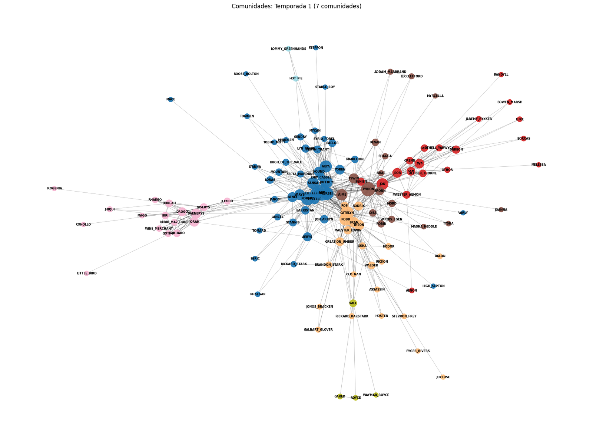
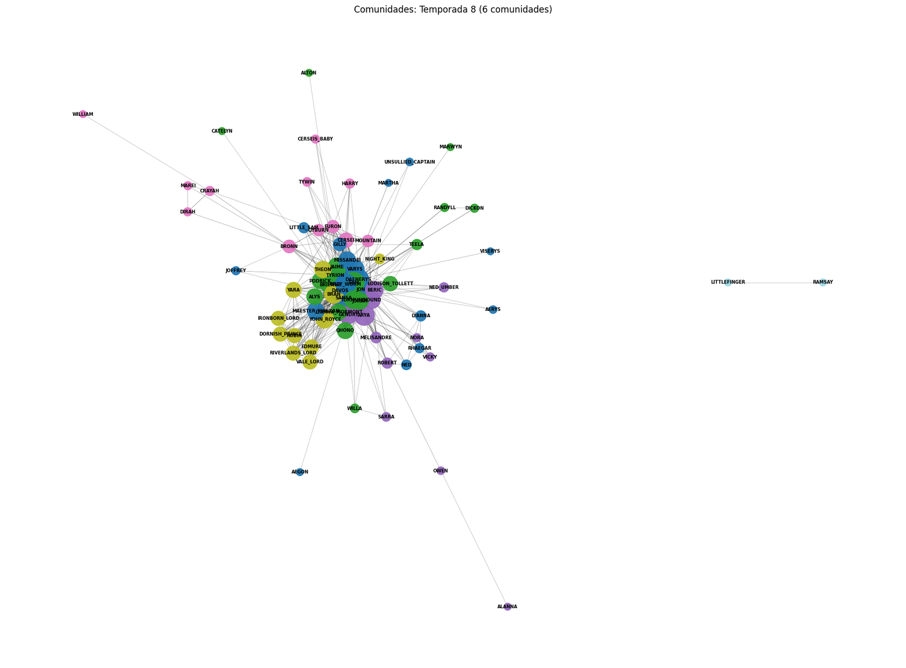

# Redes de Game of Thrones

Análise de grafos das interações entre personagens da 1ª e da 8ª temporada de Game of Thrones, feita no curso de Tecnologia em Inteligência Artificial Aplicada da PUCPR. Cada personagem é um vértice, e cada aresta liga dois personagens que interagem, com peso igual ao número de interações na temporada.

O notebook [`relatorio_got_redes.ipynb`](relatorio_got_redes.ipynb) faz três coisas:

1. **Métricas da rede:** vértices, arestas, grau, densidade, transitividade e componentes, com o histograma de graus de cada temporada.
2. **Centralidade:** os 3 personagens mais centrais por grau, intermediação, proximidade e autovetor.
3. **Comunidades:** detecção por modularidade (`greedy_modularity_communities`, ponderada pelo número de interações) e desenho dos grafos coloridos por comunidade.

## Resultados

| | Temporada 1 | Temporada 8 |
|---|---:|---:|
| Personagens (vértices) | 126 | 74 |
| Interações (arestas) | 549 | 553 |
| Grau médio | 8,71 | 14,95 |
| Densidade | 0,070 | 0,205 |
| Transitividade | 0,383 | 0,644 |
| Comunidades | 7 | 6 |

A 8ª temporada tem bem menos personagens e quase o mesmo número de interações. Por isso a rede fica três vezes mais densa e bem mais agrupada: a história se concentra em poucos núcleos no final da série.

Quem mais aparece no centro da rede:

- **Temporada 1:** Ned lidera as quatro medidas de centralidade. Tyrion, Robert e Catelyn vêm logo atrás.
- **Temporada 8:** a centralidade fica dividida. Sam lidera grau e proximidade, Daenerys lidera intermediação e Tyrion lidera autovetor.





## Como rodar

```bash
pip install -r requirements.txt
jupyter notebook relatorio_got_redes.ipynb
```

O notebook baixa os dados direto da fonte, então precisa de internet.

## Dados

Rede de interações de [mathbeveridge/gameofthrones](https://github.com/mathbeveridge/gameofthrones), de Andrew Beveridge, sob a licença [CC BY-NC-SA 4.0](https://creativecommons.org/licenses/by-nc-sa/4.0/). Os arquivos de dados não estão neste repositório.
